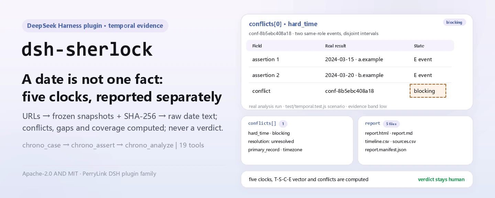
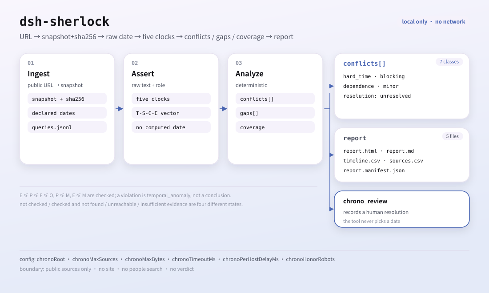
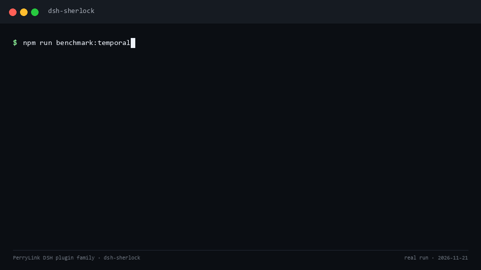

<div align="center">

<picture>
  <source media="(prefers-color-scheme: dark)" srcset="docs/assets/dsh-sherlock-hero-en-dark.webp">
  
</picture>

# dsh-sherlock

**Un banco de trabajo de evidencia temporal: una fecha nunca es un solo hecho.**

*URLs → instantáneas congeladas + SHA-256 → afirmaciones de fecha en bruto con cinco relojes y un vector T-S-C-E → conflictos, vacíos y cobertura deterministas → un informe local. Informa de lo que la evidencia respalda y de lo que entra en conflicto; nunca emite un veredicto de verdadero/falso. No construye ni aloja ningún sitio web y no busca personas.*

Última verificación: DeepSeek Harness `dsh-v0.2.3-alpha.1` (2026-11-22).

[English](README.md) · [简体中文](README.zh.md) · [Español](README-es.md) · [Português](README-pt.md) · [हिन्दी](README-hi.md)

[](https://github.com/PerryLink/dsh-sherlock/actions/workflows/ci.yml)
[](LICENSE)
[]()

</div>

> El nombre se conserva por continuidad. La dirección del producto es la evidencia temporal, no la enumeración de nombres de usuario.

---

## Qué hace

`chrono_case` → `chrono_ingest` / `chrono_feed` / `chrono_gdelt` / `chrono_archive` → `chrono_assert` → `chrono_analyze` → `chrono_report`

- **chrono_case** crea/abre un caso local.
- **chrono_ingest** obtiene de 1 a 10 URLs públicas, guarda instantáneas de texto y SHA-256, y extrae las fechas declaradas.
- **chrono_assert** registra un evento y sus afirmaciones de fecha en bruto con un rol (`event`, `announcement`, `effective`, `publication`, `update`, `correction`, `retraction`, `access`, `deadline`, `period`).
- **chrono_analyze** ejecuta un análisis determinista de conflictos/evidencia/línea de tiempo/vacíos/cobertura.
- Cada fuente/consulta se registra en `queries.jsonl`; el informe incluye un registro de consultas y el TEG por cada valor temporal. La puerta de robots y el retardo por host se aplican a la ingesta de URLs.
- **chrono_report** escribe un `report.html` autocontenido, `report.md`, `timeline.csv`, `sources.csv` y `report.manifest.json`; `presentFiles` recomienda cuatro.
- La skill `chrono-investigation` contiene el método: cinco relojes, T-S-C-E, tratamiento de conflictos, lenguaje de incertidumbre.

### Cinco relojes (nunca colapsados en una única "fecha")

| Eje | Significado |
|---|---|
| **E** Event | cuándo ocurrió o entró en vigor el evento afirmado |
| **P** Publication | cuándo se hizo pública por primera vez la afirmación |
| **F** First seen | la prueba más temprana de que alguien pudo haberlo visto (archivo) |
| **O** Observed | cuándo lo obtuvo este banco de trabajo |
| **M** Modified | cuándo la fuente dice que fue editado/retractado |

Se comprueban los axiomas de precedencia `E ≤ P ≤ F ≤ O`, `P ≤ M`, `E ≤ M`; una violación es un `temporal_anomaly`, no una conclusión.

### Vector de evidencia T-S-C-E

Cada evento/afirmación lleva:

- **T** precisión temporal/zona horaria/rol,
- **S** trazabilidad de la fuente,
- **C** corroboración independiente,
- **E** reproducibilidad de instantánea/span/hash.

El informe muestra el vector y una banda (`low`/`medium`/`high`), no un único "porcentaje de credibilidad". Una sola fuente o una copia sindicada nunca pueden ser `high`.

### Clases de conflicto de fechas

`hard_time` (mismo rol, precisión comparable, intervalos disjuntos), `role_mismatch`, `precision_mismatch`, `timezone_ambiguity`, `sequence`, `version`, `dependence`. El informe dice qué resolvería un conflicto; no elige una fecha "verdadera".

### Declaración de cobertura

Una conclusión negativa requiere una declaración de cobertura: qué se consultó, dónde, en qué ventana/idioma/ámbito de dominio, cuándo, cuántos resultados y qué fue inaccesible. `not checked`, `checked and not found`, `unreachable` e `insufficient evidence` son distintos.

<picture>
  <source media="(prefers-color-scheme: dark)" srcset="docs/assets/dsh-sherlock-flow-v5-dark.svg">
  
</picture>

*Estructura: ingesta → afirmación → análisis; `conflicts[]`, `gaps[]` y `coverage` se calculan de forma determinista, y los cinco relojes nunca se colapsan en una sola “fecha”. Las etiquetas del diagrama son los nombres reales de las herramientas y de los campos, así que la misma imagen sirve para los cinco idiomas.*

## Inicio rápido

```bash
dsh plugin --profile <profile> add dsh-sherlock
```

Pídele a DSH:

```text
Create a temporal case for this question: "When did Acme announce the factory closure, and why do the two sources disagree?"
I have these URLs: ...
Use chrono_case, chrono_ingest, chrono_assert, chrono_analyze, and chrono_report.
Do not decide which source is true; show the date roles, conflicts, gaps, and what would resolve them.
```

O llama a las herramientas directamente en PTC:

```js
const c = await tools.chrono_case({
  action: 'create',
  title: 'Acme closure timeline',
  question: 'When did Acme announce the closure?',
  purpose: 'internal',
  subject_type: 'organization',
  subject_name: 'Acme'
})
await tools.chrono_ingest({ case_id: c.caseId, urls: ['https://example.com/notice'] })
// Read the returned source id, then record the raw date text. Do not calculate the date.
await tools.chrono_assert({
  case_id: c.caseId,
  source_id: '<source-id>',
  event_label: 'Acme announced the closure',
  event_category: 'corporate',
  dates: [{ raw_text: '2024年3月15日', role: 'announcement' }]
})
await tools.chrono_analyze({ case_id: c.caseId, action: 'check' })
await tools.chrono_report({ case_id: c.caseId, audience: 'internal' })
```

Ejecuta `npm run benchmark:temporal` para el benchmark temporal local (sin red).

Los informes admiten `redaction: internal | client | public | legal`; la PII en etiquetas, claims, títulos y registros de consultas se redacta, y `public` solo renderiza filas de banda high/medium. `chrono_index` lista/filtra casos locales sin una base de datos alojada.

La herramienta de informe escribe archivos locales, incluido un `report.html` autocontenido con el tablero de línea de tiempo/conflictos. El modelo debe llamar a `present` de DSH con los cuatro `presentFiles` (`report.html`, `report.md`, `timeline.csv`, `report.manifest.json`); `sources.csv` permanece en el caso. El plugin no los sube. Una persona puede usar `/chrono list`, `/chrono status <caseId>` o `/chrono report <caseId>`.

## Herramientas

| Herramienta | Propósito |
|---|---|
| `chrono_case` | crear/abrir/listar un caso local |
| `chrono_search` | descubrimiento opcional vía la búsqueda de DSH; devuelve URLs, no evidencia |
| `chrono_plan` | plan de consultas determinista (sujeto/alias/evento/ventanas) |
| `chrono_ingest` | congelar instantáneas de URLs públicas + metadatos |
| `chrono_index` | listar/buscar casos locales |
| `chrono_feed` | entradas RSS/Atom + ingesta opcional |
| `chrono_gdelt` | descubrimiento de noticias GDELT DOC 2.0 + ingesta opcional |
| `chrono_archive` | capturas de Wayback CDX; opcional y con degradación |
| `chrono_collect` | hasta 50 URLs; job de DSH o ejecución en primer plano |
| `chrono_watch` | vigilancia local duradera vía DSH schedule |
| `chrono_diff` | diff determinista contra un informe anterior |
| `chrono_verify` | volver a obtener una fuente y registrar la deriva de hash/estado |
| `chrono_claim` | registrar una claim/declaración en el caso |
| `chrono_review` | revisión/resolución humana de un conflicto |
| `chrono_assert` | registrar eventos y afirmaciones de fecha en bruto |
| `chrono_analyze` | conflictos, vectores de evidencia, línea de tiempo, vacíos, cobertura |
| `chrono_report` | `report.html` visual + Markdown/CSV + hashes del manifiesto |
| `sherlock_check` | **legacy**: comprobación de nombre de usuario; se mantiene para usuarios existentes |
| `sherlock_sites` | **legacy**: lista de sitios |

La skill `sherlock-osint` se conserva para explicar por qué ahora es legacy. El flujo principal es `chrono-investigation`.

## Almacén local de casos

Raíz por defecto: `.dsh-sherlock/chrono` bajo el directorio de trabajo del host.

```text
cases/<caseId>/
  case.json
  sources.jsonl
  watch.json
  events.jsonl
  dates.jsonl
  snapshots/<snapshotId>.txt
  conflicts.json
  gaps.json
  coverage.json
  reports/<reportId>/
    report.md
    timeline.csv
    sources.csv
    report.manifest.json
```

No se crea ningún sitio web, servidor, cuenta ni base de datos externa. Los ID de caso los genera el plugin; el modelo no puede pasar una ruta del sistema de archivos.

## Configuración

```yaml
- insert:
    - id: dsh-sherlock
      name: dsh-sherlock
      config:
        chronoRoot: .dsh-sherlock/chrono
        chronoMaxSources: 50
        chronoMaxBytes: 2097152
        chronoTimeoutMs: 15000
        chronoPerHostDelayMs: 250
        chronoHonorRobots: true
        # legacy username tools
        defaultScope: core
        maxSites: 120
        concurrency: 10
        perHostDelayMs: 350
        timeoutMs: 10000
        toolTimeoutMs: 180000
        maxResponseBytes: 524288
        maxVerify: 30
        cacheTtlMs: 600000
        includeNsfw: false
        honorExclusions: true
        allowPrivateHosts: false
```

Las herramientas temporales rechazan hosts privados/loopback. `allowPrivateHosts` pertenece a la ruta legacy solo para pruebas; no lo habilites en un perfil.

## Seguridad y límites

- Solo fuentes públicas; sin inicio de sesión, muro de pago, CAPTCHA, evasión de WAF ni uso de credenciales.
- Sin sitio propio, SaaS, red de rastreadores ni recolección masiva.
- Sin conclusión de identidad/atribución; sin búsqueda de personas, doxxing ni decisiones de alto impacto.
- Sin HTML en bruto ni texto completo de artículos en el informe; solo citas breves + enlaces + hashes.
- Un hash es una comprobación de integridad, no una marca de tiempo de confianza ni una opinión legal.
- El banco de trabajo no decide si una afirmación es verdadera; informa de lo que respalda la evidencia recopilada, lo que entra en conflicto y lo que sigue siendo desconocido.

## Herramientas legacy de nombres de usuario

`sherlock_check` y `sherlock_sites` siguen operando sobre el manifiesto en formato Sherlock fijado en `data/sites.json`, con los seis estados originales (`claimed`, `available`, `unknown`, `blocked`, `illegal`, `unreliable`), controles negativos aleatorios y un límite de 120 sitios. Están obsoletas como dirección de producto; consulta [docs/LEGACY-USERNAME.md](docs/LEGACY-USERNAME.md) para el comportamiento antiguo y el aviso de datos.

Los datos upstream tienen licencia MIT; consulta `data/SHERLOCK-LICENSE` y `NOTICE`. El código del plugin es Apache-2.0.

## Desarrollo



*Animado: la salida real por stdout de `npm run benchmark:temporal` en Node 24.22.1 sin red (reejecutado el 2026-11-21). Los tiempos varían según la máquina; los recuentos están fijados por `CHRONO_BENCH_COUNT=100`.*

Requiere Node 24.9+.

```bash
npm ci
npm run typecheck
npm run lint
npm test
npm run check
npm run gate
```

`npm run gate` ejecuta la validación de datos, el `checkJs` de TypeScript, oxlint, la suite de tests de Node y `npm pack --dry-run`. El validador de esquema real de DSH puede usarse con:

```bash
DSH_TOOLS_PATH=/path/to/dsh-tools/lib/index.js npm test
```

## Documentación

- [Modelo de evidencia temporal](docs/TIME-EVIDENCE-MODEL.md)
- [Comportamiento legacy de nombres de usuario](docs/LEGACY-USERNAME.md)
- [Paquete de datos y sincronización](docs/DATA.md)
- [Publicación](docs/RELEASING.md)
- [Notas del benchmark](docs/BENCHMARK.md)
- [Páginas de detalle del plugin](docs/DETAIL.md)
- [Política de seguridad](SECURITY.md)
- [Contribuir](CONTRIBUTING.md)

## Licencia

Apache-2.0 para el código del plugin; MIT para los datos derivados del Sherlock legacy. Véase `LICENSE`, `NOTICE`, `data/SHERLOCK-LICENSE`.
