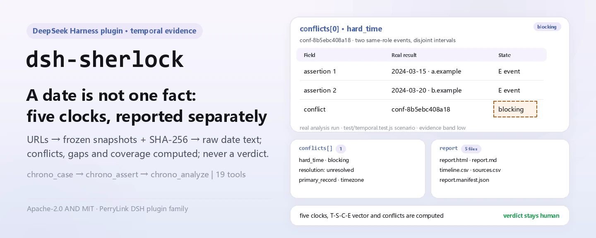
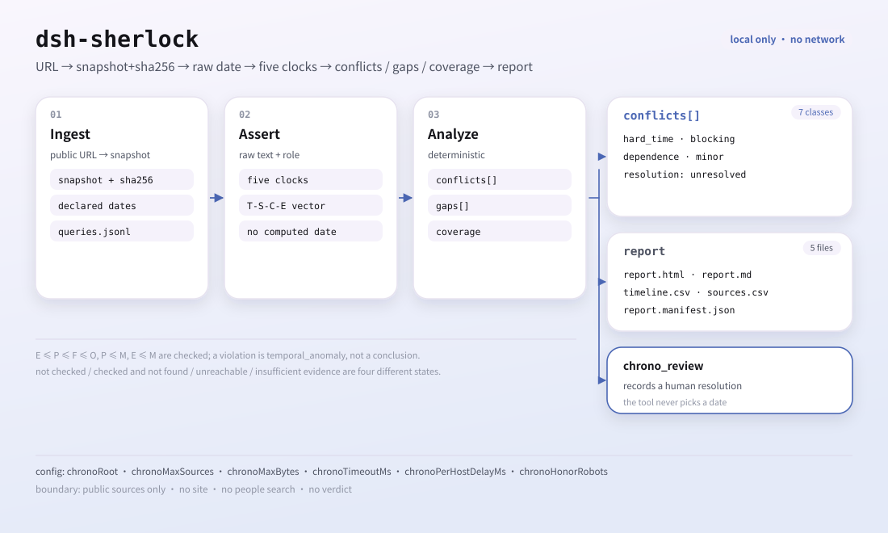
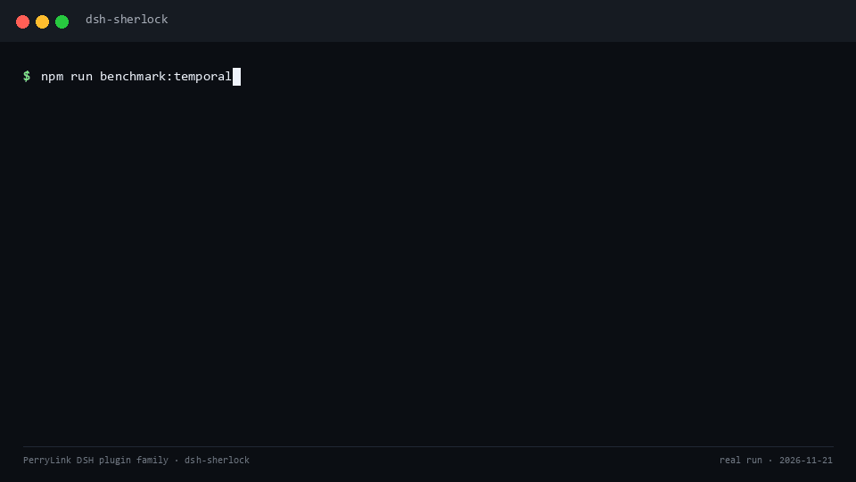

<div align="center">

<picture>
  <source media="(prefers-color-scheme: dark)" srcset="docs/assets/dsh-sherlock-hero-en-dark.webp">
  
</picture>

# dsh-sherlock

**समय-आधारित एविडेंस वर्कबेंच: एक तारीख़ कभी एक ही तथ्य नहीं होती।**

*URLs → फ़्रीज़ किए गए स्नैपशॉट + SHA-256 → पाँच घड़ियों और T-S-C-E वेक्टर वाले मूल तारीख़ दावे → नियतात्मक विरोध, अंतराल और कवरेज → एक स्थानीय रिपोर्ट। यह बताता है कि एविडेंस किस बात का समर्थन करता है और कहाँ विरोध है; यह कभी सही/ग़लत का निर्णय नहीं देता। यह कोई वेबसाइट नहीं बनाता या होस्ट नहीं करता और लोगों को नहीं खोजता।*

[English](README.md) · [简体中文](README.zh.md) · [Español](README-es.md) · [Português](README-pt.md) · [हिन्दी](README-hi.md)

[](https://github.com/PerryLink/dsh-sherlock/actions/workflows/ci.yml)
[](LICENSE)
[]()

</div>

> नाम निरंतरता के लिए रखा गया है। उत्पाद की दिशा समय-आधारित एविडेंस है, यूज़रनेम की गणना नहीं।

---

## यह क्या करता है

`chrono_case` → `chrono_ingest` / `chrono_feed` / `chrono_gdelt` / `chrono_archive` → `chrono_assert` → `chrono_analyze` → `chrono_report`

- **chrono_case** स्थानीय कেস बनाता/खोलता है।
- **chrono_ingest** 1–10 सार्वजनिक URL लाता है, टेक्स्ट स्नैपशॉट और SHA-256 सहेजता है, और घोषित तारीख़ें निकालता है।
- **chrono_assert** घटना और उसके मूल तारीख़ दावों को भूमिका के साथ दर्ज करता है (`event`, `announcement`, `effective`, `publication`, `update`, `correction`, `retraction`, `access`, `deadline`, `period`)।
- **chrono_analyze** नियतात्मक विरोध/एविडेंस/टाइमलाइन/अंतराल/कवरेज विश्लेषण चलाता है।
- हर स्रोत/क्वेरी `queries.jsonl` में दर्ज होती है; रिपोर्ट में क्वेरी लॉग और हर समय मान के लिए TEG होता है। URL इनजेशन पर robots गेट और प्रति-होस्ट देरी लागू होती है।
- **chrono_report** एक स्वयंपूर्ण `report.html`, `report.md`, `timeline.csv`, `sources.csv` और `report.manifest.json` लिखता है; `presentFiles` चार की सिफ़ारिश करता है।
- `chrono-investigation` स्किल पूरी विधि रखती है: पाँच घड़ियाँ, T-S-C-E, विरोध-प्रबंधन, अनिश्चितता की भाषा।

### पाँच घड़ियाँ (कभी एक "तारीख़" में नहीं मिलाई जातीं)

| अक्ष | अर्थ |
|---|---|
| **E** Event | दावा किया गया घटना कब हुई या लागू हुई |
| **P** Publication | यह दावा पहली बार कब सार्वजनिक हुआ |
| **F** First seen | सबसे पहला प्रमाण कि कोई इसे देख सकता था (आर्काइव) |
| **O** Observed | यह वर्कबेंच इसे कब लाया |
| **M** Modified | स्रोत के अनुसार इसे कब संपादित/वापस लिया गया |

`E ≤ P ≤ F ≤ O`, `P ≤ M`, `E ≤ M` की पूर्वता-अभिगृहीत जाँची जाती हैं; उल्लंघन एक `temporal_anomaly` है, कोई निष्कर्ष नहीं।

### T-S-C-E एविडेंस वेक्टर

हर घटना/दावा रखता है:

- **T** समय सटीकता/टाइमज़ोन/भूमिका,
- **S** स्रोत की ट्रेसबिलिटी,
- **C** स्वतंत्र पुष्टि,
- **E** स्नैपशॉट/span/हैश की पुनरुत्पादकता।

रिपोर्ट वेक्टर और एक band (`low`/`medium`/`high`) दिखाती है, कोई एकल "विश्वसनीयता प्रतिशत" नहीं। एक अकेला स्रोत या सिंडिकेटेड कॉपी कभी `high` नहीं हो सकती।

### तारीख़ विरोध की श्रेणियाँ

`hard_time` (एक ही भूमिका, तुलनीय सटीकता, अलग-अलग अंतराल), `role_mismatch`, `precision_mismatch`, `timezone_ambiguity`, `sequence`, `version`, `dependence`। रिपोर्ट बताती है कि विरोध क्या हल करेगा; वह कोई "सही" तारीख़ नहीं चुनती।

### कवरेज वक्तव्य

नकारात्मक निष्कर्ष के लिए कवरेज वक्तव्य आवश्यक है: क्या खोजा गया, कहाँ, किस समय-खिड़की/भाषा/डोमेन दायरे में, कब, कितने परिणाम, और क्या पहुँच से बाहर था। `not checked`, `checked and not found`, `unreachable` और `insufficient evidence` अलग-अलग हैं।


<picture>
  <source media="(prefers-color-scheme: dark)" srcset="docs/assets/dsh-sherlock-flow-v5-dark.svg">
  
</picture>

*संरचना: इनजेस्ट → दावा → विश्लेषण; `conflicts[]`, `gaps[]` और `coverage` नियतात्मक रूप से गणना किए जाते हैं, और पाँच घड़ियाँ कभी एक “तारीख़” में नहीं मिलाई जातीं। आरेख में केवल असली टूल और फ़ील्ड नाम हैं, इसलिए एक ही चित्र पाँचों भाषाओं के लिए काम करता है।*

## त्वरित शुरुआत

```bash
dsh plugin --profile <profile> add dsh-sherlock
```

DSH से कहें:

```text
Create a temporal case for this question: "When did Acme announce the factory closure, and why do the two sources disagree?"
I have these URLs: ...
Use chrono_case, chrono_ingest, chrono_assert, chrono_analyze, and chrono_report.
Do not decide which source is true; show the date roles, conflicts, gaps, and what would resolve them.
```

या PTC में टूल सीधे कॉल करें:

```js
const c = await tools.chrono_case({
  action: 'create',
  title: 'Acme closure timeline',
  question: 'When did Acme announce the closure?',
  purpose: 'internal',
  subject_type: 'organization',
  subject_name: 'Acme'
})
await tools.chrono_ingest({ case_id: c.caseId, urls: ['https://example.com/notice'] })
// Read the returned source id, then record the raw date text. Do not calculate the date.
await tools.chrono_assert({
  case_id: c.caseId,
  source_id: '<source-id>',
  event_label: 'Acme announced the closure',
  event_category: 'corporate',
  dates: [{ raw_text: '2024年3月15日', role: 'announcement' }]
})
await tools.chrono_analyze({ case_id: c.caseId, action: 'check' })
await tools.chrono_report({ case_id: c.caseId, audience: 'internal' })
```

स्थानीय टेम्पोरल बेंचमार्क (बिना नेटवर्क) के लिए `npm run benchmark:temporal` चलाएँ।

रिपोर्ट `redaction: internal | client | public | legal` समर्थित करती हैं; लेबल, claims, शीर्षक और क्वेरी लॉग में PII छिपाया जाता है, और `public` केवल high/medium-band पंक्तियाँ दिखाता है। `chrono_index` बिना किसी होस्टेड डेटाबेस के स्थानीय केस सूचीबद्ध/फ़िल्टर करता है।

रिपोर्ट टूल स्थानीय फ़ाइलें लिखता है, जिनमें एक स्वयंपूर्ण `report.html` टाइमलाइन/विरोध बोर्ड शामिल है। मॉडल को DSH `present` को चार `presentFiles` (`report.html`, `report.md`, `timeline.csv`, `report.manifest.json`) के साथ कॉल करना चाहिए; `sources.csv` केस में ही रहता है। प्लगइन उन्हें अपलोड नहीं करता। कोई व्यक्ति `/chrono list`, `/chrono status <caseId>` या `/chrono report <caseId>` इस्तेमाल कर सकता है।

## टूल

| टूल | उद्देश्य |
|---|---|
| `chrono_case` | स्थानीय केस बनाएँ/खोलें/सूचीबद्ध करें |
| `chrono_search` | DSH search के ज़रिए वैकल्पिक खोज; URLs लौटाता है, एविडेंस नहीं |
| `chrono_plan` | नियतात्मक क्वेरी योजना (विषय/उपनाम/घटना/समय-खिड़कियाँ) |
| `chrono_ingest` | सार्वजनिक URL स्नैपशॉट + मेटाडेटा फ़्रीज़ करें |
| `chrono_index` | स्थानीय केस सूचीबद्ध/खोजें |
| `chrono_feed` | RSS/Atom प्रविष्टियाँ + वैकल्पिक इनजेशन |
| `chrono_gdelt` | GDELT DOC 2.0 समाचार खोज + वैकल्पिक इनजेशन |
| `chrono_archive` | Wayback CDX कैप्चर; वैकल्पिक और fallback-aware |
| `chrono_collect` | 50 URL तक; DSH job या foreground fallback |
| `chrono_watch` | DSH schedule के ज़रिए टिकाऊ स्थानीय निगरानी |
| `chrono_diff` | पिछली रिपोर्ट के मुक़ाबले नियतात्मक diff |
| `chrono_verify` | किसी स्रोत को दोबारा लाकर hash/status drift दर्ज करें |
| `chrono_claim` | केस में claim/कथन दर्ज करें |
| `chrono_review` | विरोध की मानवीय समीक्षा/समाधान |
| `chrono_assert` | घटनाएँ और मूल तारीख़ दावे दर्ज करें |
| `chrono_analyze` | विरोध, एविडेंस वेक्टर, टाइमलाइन, अंतराल, कवरेज |
| `chrono_report` | दृश्य `report.html` + Markdown/CSV + manifest हैश |
| `sherlock_check` | **legacy**: यूज़रनेम जाँच; मौजूदा उपयोगकर्ताओं के लिए रखा गया |
| `sherlock_sites` | **legacy**: साइट सूची |

`sherlock-osint` स्किल इस बात के लिए रखी गई है कि यह अब legacy क्यों है। मुख्य वर्कफ़्लो `chrono-investigation` है।

## स्थानीय केस स्टोर

डिफ़ॉल्ट रूट: होस्ट वर्किंग डायरेक्टरी के अंतर्गत `.dsh-sherlock/chrono`।

```text
cases/<caseId>/
  case.json
  sources.jsonl
  watch.json
  events.jsonl
  dates.jsonl
  snapshots/<snapshotId>.txt
  conflicts.json
  gaps.json
  coverage.json
  reports/<reportId>/
    report.md
    timeline.csv
    sources.csv
    report.manifest.json
```

कोई वेबसाइट, सर्वर, खाता या बाहरी डेटाबेस नहीं बनाया जाता। केस ID प्लगइन बनाता है; मॉडल फ़ाइलसिस्टम पथ नहीं दे सकता।

## कॉन्फ़िगरेशन

```yaml
- insert:
    - id: dsh-sherlock
      name: dsh-sherlock
      config:
        chronoRoot: .dsh-sherlock/chrono
        chronoMaxSources: 50
        chronoMaxBytes: 2097152
        chronoTimeoutMs: 15000
        chronoPerHostDelayMs: 250
        chronoHonorRobots: true
        # legacy username tools
        defaultScope: core
        maxSites: 120
        concurrency: 10
        perHostDelayMs: 350
        timeoutMs: 10000
        toolTimeoutMs: 180000
        maxResponseBytes: 524288
        maxVerify: 30
        cacheTtlMs: 600000
        includeNsfw: false
        honorExclusions: true
        allowPrivateHosts: false
```

टेम्पोरल टूल निजी/लूपबैक होस्ट अस्वीकार करते हैं। `allowPrivateHosts` केवल-परीक्षण वाले legacy पथ का है; इसे किसी प्रोफ़ाइल में सक्षम न करें।

## सुरक्षा और सीमाएँ

- केवल सार्वजनिक स्रोत; कोई लॉगिन, पेवॉल, CAPTCHA, WAF बायपास या क्रेडेंशियल उपयोग नहीं।
- कोई स्व-होस्टेड साइट, SaaS, क्रॉलर नेटवर्क या थोक संग्रह नहीं।
- कोई पहचान/श्रेय निष्कर्ष नहीं; कोई लोगों की खोज, doxxing या उच्च-प्रभाव निर्णय नहीं।
- रिपोर्ट में कोई कच्चा HTML/पूरा लेख टेक्स्ट नहीं; केवल छोटे उद्धरण + लिंक + हैश।
- हैश एक अखंडता जाँच है, कोई विश्वसनीय टाइमस्टैम्प या कानूनी राय नहीं।
- वर्कबेंच यह तय नहीं करता कि कोई दावा सच है; यह बताता है कि एकत्रित एविडेंस किस बात का समर्थन करता है, कहाँ विरोध है और क्या अज्ञात रहता है।

## लेगेसी यूज़रनेम टूल

`sherlock_check` और `sherlock_sites` अब भी `data/sites.json` में पिन किए गए Sherlock-फ़ॉर्मेट manifest पर काम करते हैं, जिसमें मूल छह अवस्थाएँ (`claimed`, `available`, `unknown`, `blocked`, `illegal`, `unreliable`), यादृच्छिक नकारात्मक नियंत्रण और 120-साइट सीमा है। उत्पाद-दिशा के रूप में इन्हें अप्रचलित माना गया है; पुराने व्यवहार और डेटा सूचना के लिए [docs/LEGACY-USERNAME.md](docs/LEGACY-USERNAME.md) देखें।

अपस्ट्रीम डेटा MIT-लाइसेंस्ड है; देखें `data/SHERLOCK-LICENSE` और `NOTICE`। प्लगइन कोड Apache-2.0 है।

## विकास



*एनिमेटेड: `npm run benchmark:temporal` का असली stdout, Node 24.22.1 पर बिना नेटवर्क (2026-11-21 को दोबारा चलाया गया)। समय मशीन के अनुसार बदलता है; गणनाएँ `CHRONO_BENCH_COUNT=100` से तय हैं।*


Node 24.9+ आवश्यक है।

```bash
npm ci
npm run typecheck
npm run lint
npm test
npm run check
npm run gate
```

`npm run gate` डेटा वैलिडेशन, TypeScript `checkJs`, oxlint, Node टेस्ट सूट और `npm pack --dry-run` चलाता है। असली DSH स्कीमा वैलिडेटर इस तरह इस्तेमाल किया जा सकता है:

```bash
DSH_TOOLS_PATH=/path/to/dsh-tools/lib/index.js npm test
```

## दस्तावेज़ीकरण

- [समय-एविडेंस मॉडल](docs/TIME-EVIDENCE-MODEL.md)
- [लेगेसी यूज़रनेम व्यवहार](docs/LEGACY-USERNAME.md)
- [डेटा पैक और सिंक](docs/DATA.md)
- [रिलीज़िंग](docs/RELEASING.md)
- [बेंचमार्क नोट्स](docs/BENCHMARK.md)
- [प्लगइन विवरण पृष्ठ](docs/DETAIL.md)
- [सुरक्षा नीति](SECURITY.md)
- [योगदान](CONTRIBUTING.md)

## लाइसेंस

प्लगइन कोड Apache-2.0; लेगेसी Sherlock-व्युत्पन्न डेटा MIT। देखें `LICENSE`, `NOTICE`, `data/SHERLOCK-LICENSE`।
