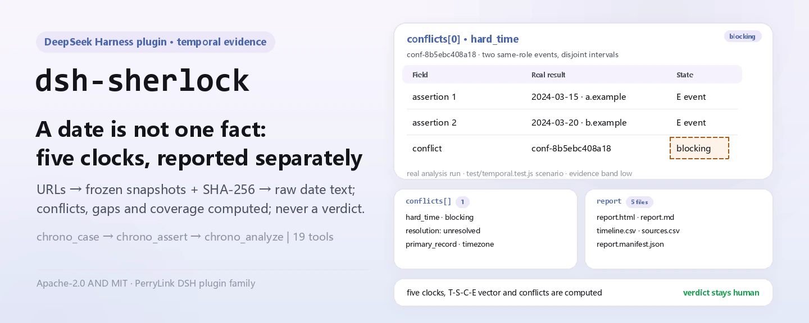
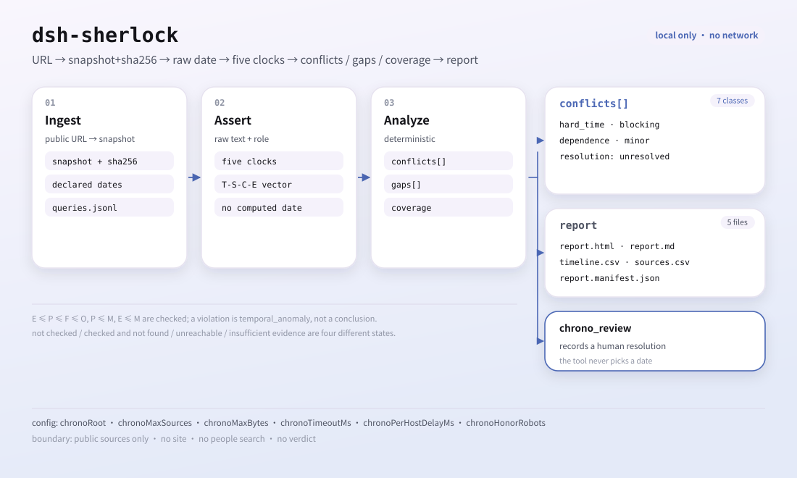
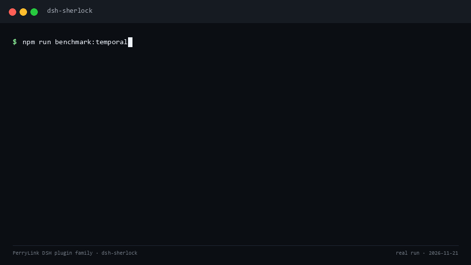

<div align="center">

<picture>
  <source media="(prefers-color-scheme: dark)" srcset="docs/assets/dsh-sherlock-hero-en-dark.webp">
  
</picture>

# dsh-sherlock

**Uma bancada de evidência temporal: uma data nunca é um único fato.**

*URLs → snapshots congelados + SHA-256 → afirmações de data em bruto com cinco relógios e um vetor T-S-C-E → conflitos, lacunas e cobertura determinísticos → um relatório local. Ele informa o que a evidência sustenta e o que entra em conflito; nunca emite um veredicto de verdadeiro/falso. Não constrói nem hospeda nenhum site e não procura pessoas.*

Última verificação: DeepSeek Harness `dsh-v0.2.3-alpha.1` (2026-11-22).

[English](README.md) · [简体中文](README.zh.md) · [Español](README-es.md) · [Português](README-pt.md) · [हिन्दी](README-hi.md)

[](https://github.com/PerryLink/dsh-sherlock/actions/workflows/ci.yml)
[](LICENSE)
[]()

</div>

> O nome é mantido por continuidade. A direção do produto é evidência temporal, não enumeração de nomes de usuário.

---

## O que faz

`chrono_case` → `chrono_ingest` / `chrono_feed` / `chrono_gdelt` / `chrono_archive` → `chrono_assert` → `chrono_analyze` → `chrono_report`

- **chrono_case** cria/abre um caso local.
- **chrono_ingest** busca de 1 a 10 URLs públicas, guarda snapshots de texto e SHA-256, e extrai as datas declaradas.
- **chrono_assert** registra um evento e suas afirmações de data em bruto com um papel (`event`, `announcement`, `effective`, `publication`, `update`, `correction`, `retraction`, `access`, `deadline`, `period`).
- **chrono_analyze** executa uma análise determinística de conflitos/evidência/linha do tempo/lacunas/cobertura.
- Cada fonte/consulta é registrada em `queries.jsonl`; o relatório tem um log de consultas e TEG por valor de tempo. O gate de robots e o atraso por host se aplicam à ingestão de URLs.
- **chrono_report** grava um `report.html` autocontido, `report.md`, `timeline.csv`, `sources.csv` e `report.manifest.json`; `presentFiles` recomenda quatro.
- A skill `chrono-investigation` carrega o método: cinco relógios, T-S-C-E, tratamento de conflitos, linguagem de incerteza.

### Cinco relógios (nunca colapsados em uma única "data")

| Eixo | Significado |
|---|---|
| **E** Event | quando o evento afirmado aconteceu ou entrou em vigor |
| **P** Publication | quando a afirmação foi tornada pública pela primeira vez |
| **F** First seen | a prova mais antiga de que alguém poderia tê-la visto (arquivo) |
| **O** Observed | quando esta bancada a buscou |
| **M** Modified | quando a fonte diz que foi editada/retratada |

Os axiomas de precedência `E ≤ P ≤ F ≤ O`, `P ≤ M`, `E ≤ M` são verificados; uma violação é um `temporal_anomaly`, não uma conclusão.

### Vetor de evidência T-S-C-E

Cada evento/afirmação carrega:

- **T** precisão temporal/fuso horário/papel,
- **S** rastreabilidade da fonte,
- **C** corroboração independente,
- **E** reprodutibilidade de snapshot/span/hash.

O relatório mostra o vetor e uma banda (`low`/`medium`/`high`), não uma única "porcentagem de credibilidade". Uma única fonte ou uma cópia sindicada nunca pode ser `high`.

### Classes de conflito de datas

`hard_time` (mesmo papel, precisão comparável, intervalos disjuntos), `role_mismatch`, `precision_mismatch`, `timezone_ambiguity`, `sequence`, `version`, `dependence`. O relatório diz o que resolveria um conflito; ele não escolhe uma data "verdadeira".

### Declaração de cobertura

Uma conclusão negativa exige uma declaração de cobertura: o que foi consultado, onde, em que janela/idioma/escopo de domínio, quando, quantos resultados e o que estava inacessível. `not checked`, `checked and not found`, `unreachable` e `insufficient evidence` são distintos.

<picture>
  <source media="(prefers-color-scheme: dark)" srcset="docs/assets/dsh-sherlock-flow-v5-dark.svg">
  
</picture>

*Estrutura: ingestão → afirmação → análise; `conflicts[]`, `gaps[]` e `coverage` são calculados de forma determinística, e os cinco relógios nunca são colapsados em uma única “data”. Os rótulos do diagrama são os nomes reais das ferramentas e dos campos, então a mesma imagem serve aos cinco idiomas.*

## Início rápido

```bash
dsh plugin --profile <profile> add dsh-sherlock
```

Peça ao DSH:

```text
Create a temporal case for this question: "When did Acme announce the factory closure, and why do the two sources disagree?"
I have these URLs: ...
Use chrono_case, chrono_ingest, chrono_assert, chrono_analyze, and chrono_report.
Do not decide which source is true; show the date roles, conflicts, gaps, and what would resolve them.
```

Ou chame as ferramentas diretamente no PTC:

```js
const c = await tools.chrono_case({
  action: 'create',
  title: 'Acme closure timeline',
  question: 'When did Acme announce the closure?',
  purpose: 'internal',
  subject_type: 'organization',
  subject_name: 'Acme'
})
await tools.chrono_ingest({ case_id: c.caseId, urls: ['https://example.com/notice'] })
// Read the returned source id, then record the raw date text. Do not calculate the date.
await tools.chrono_assert({
  case_id: c.caseId,
  source_id: '<source-id>',
  event_label: 'Acme announced the closure',
  event_category: 'corporate',
  dates: [{ raw_text: '2024年3月15日', role: 'announcement' }]
})
await tools.chrono_analyze({ case_id: c.caseId, action: 'check' })
await tools.chrono_report({ case_id: c.caseId, audience: 'internal' })
```

Execute `npm run benchmark:temporal` para o benchmark temporal local (sem rede).

Os relatórios aceitam `redaction: internal | client | public | legal`; PII em rótulos, claims, títulos e logs de consulta é redigida, e `public` só renderiza linhas de banda high/medium. `chrono_index` lista/filtra casos locais sem um banco de dados hospedado.

A ferramenta de relatório grava arquivos locais, incluindo um `report.html` autocontido com o painel de linha do tempo/conflitos. O modelo deve chamar `present` do DSH com os quatro `presentFiles` (`report.html`, `report.md`, `timeline.csv`, `report.manifest.json`); `sources.csv` permanece no caso. O plugin não os envia. Uma pessoa pode usar `/chrono list`, `/chrono status <caseId>` ou `/chrono report <caseId>`.

## Ferramentas

| Ferramenta | Propósito |
|---|---|
| `chrono_case` | criar/abrir/listar um caso local |
| `chrono_search` | descoberta opcional via busca do DSH; retorna URLs, não evidência |
| `chrono_plan` | plano de consultas determinístico (sujeito/alias/evento/janelas) |
| `chrono_ingest` | congelar snapshots de URLs públicas + metadados |
| `chrono_index` | listar/pesquisar casos locais |
| `chrono_feed` | entradas RSS/Atom + ingestão opcional |
| `chrono_gdelt` | descoberta de notícias GDELT DOC 2.0 + ingestão opcional |
| `chrono_archive` | capturas do Wayback CDX; opcional e com degradação |
| `chrono_collect` | até 50 URLs; job do DSH ou execução em primeiro plano |
| `chrono_watch` | vigilância local durável via DSH schedule |
| `chrono_diff` | diff determinístico contra um relatório anterior |
| `chrono_verify` | rebuscar uma fonte e registrar deriva de hash/status |
| `chrono_claim` | registrar uma claim/declaração no caso |
| `chrono_review` | revisão/resolução humana de um conflito |
| `chrono_assert` | registrar eventos e afirmações de data em bruto |
| `chrono_analyze` | conflitos, vetores de evidência, linha do tempo, lacunas, cobertura |
| `chrono_report` | `report.html` visual + Markdown/CSV + hashes do manifesto |
| `sherlock_check` | **legacy**: verificação de nome de usuário; mantida para usuários existentes |
| `sherlock_sites` | **legacy**: lista de sites |

A skill `sherlock-osint` é mantida para explicar por que agora é legacy. O fluxo principal é `chrono-investigation`.

## Armazenamento local de casos

Raiz padrão: `.dsh-sherlock/chrono` sob o diretório de trabalho do host.

```text
cases/<caseId>/
  case.json
  sources.jsonl
  watch.json
  events.jsonl
  dates.jsonl
  snapshots/<snapshotId>.txt
  conflicts.json
  gaps.json
  coverage.json
  reports/<reportId>/
    report.md
    timeline.csv
    sources.csv
    report.manifest.json
```

Nenhum site, servidor, conta ou banco de dados externo é criado. Os IDs de caso são gerados pelo plugin; o modelo não pode passar um caminho do sistema de arquivos.

## Configuração

```yaml
- insert:
    - id: dsh-sherlock
      name: dsh-sherlock
      config:
        chronoRoot: .dsh-sherlock/chrono
        chronoMaxSources: 50
        chronoMaxBytes: 2097152
        chronoTimeoutMs: 15000
        chronoPerHostDelayMs: 250
        chronoHonorRobots: true
        # legacy username tools
        defaultScope: core
        maxSites: 120
        concurrency: 10
        perHostDelayMs: 350
        timeoutMs: 10000
        toolTimeoutMs: 180000
        maxResponseBytes: 524288
        maxVerify: 30
        cacheTtlMs: 600000
        includeNsfw: false
        honorExclusions: true
        allowPrivateHosts: false
```

As ferramentas temporais rejeitam hosts privados/loopback. `allowPrivateHosts` pertence ao caminho legacy somente para testes; não o habilite em um perfil.

## Segurança e limites

- Apenas fontes públicas; sem login, paywall, CAPTCHA, contorno de WAF ou uso de credenciais.
- Sem site próprio, SaaS, rede de rastreadores ou coleta em massa.
- Sem conclusão de identidade/atribuição; sem busca de pessoas, doxxing ou decisões de alto impacto.
- Sem HTML bruto/texto completo de artigos no relatório; apenas citações curtas + links + hashes.
- Um hash é uma verificação de integridade, não um carimbo de tempo confiável nem uma opinião legal.
- A bancada não decide se uma afirmação é verdadeira; informa o que a evidência coletada sustenta, o que entra em conflito e o que permanece desconhecido.

## Ferramentas legacy de nomes de usuário

`sherlock_check` e `sherlock_sites` ainda operam sobre o manifesto em formato Sherlock fixado em `data/sites.json`, com os seis estados originais (`claimed`, `available`, `unknown`, `blocked`, `illegal`, `unreliable`), controles negativos aleatórios e limite de 120 sites. Estão obsoletas como direção de produto; veja [docs/LEGACY-USERNAME.md](docs/LEGACY-USERNAME.md) para o comportamento antigo e o aviso de dados.

Os dados upstream são licenciados sob MIT; veja `data/SHERLOCK-LICENSE` e `NOTICE`. O código do plugin é Apache-2.0.

## Desenvolvimento



*Animado: a saída real por stdout de `npm run benchmark:temporal` no Node 24.22.1 sem rede (reexecutado em 2026-11-21). Os tempos variam conforme a máquina; as contagens são fixadas por `CHRONO_BENCH_COUNT=100`.*

Requer Node 24.9+.

```bash
npm ci
npm run typecheck
npm run lint
npm test
npm run check
npm run gate
```

`npm run gate` executa a validação de dados, o `checkJs` do TypeScript, oxlint, a suíte de testes do Node e `npm pack --dry-run`. O validador de esquema real do DSH pode ser usado com:

```bash
DSH_TOOLS_PATH=/path/to/dsh-tools/lib/index.js npm test
```

## Documentação

- [Modelo de evidência temporal](docs/TIME-EVIDENCE-MODEL.md)
- [Comportamento legacy de nomes de usuário](docs/LEGACY-USERNAME.md)
- [Pacote de dados e sincronização](docs/DATA.md)
- [Publicação](docs/RELEASING.md)
- [Notas do benchmark](docs/BENCHMARK.md)
- [Páginas de detalhe do plugin](docs/DETAIL.md)
- [Política de segurança](SECURITY.md)
- [Contribuição](CONTRIBUTING.md)

## Licença

Apache-2.0 para o código do plugin; MIT para os dados derivados do Sherlock legacy. Veja `LICENSE`, `NOTICE`, `data/SHERLOCK-LICENSE`.
